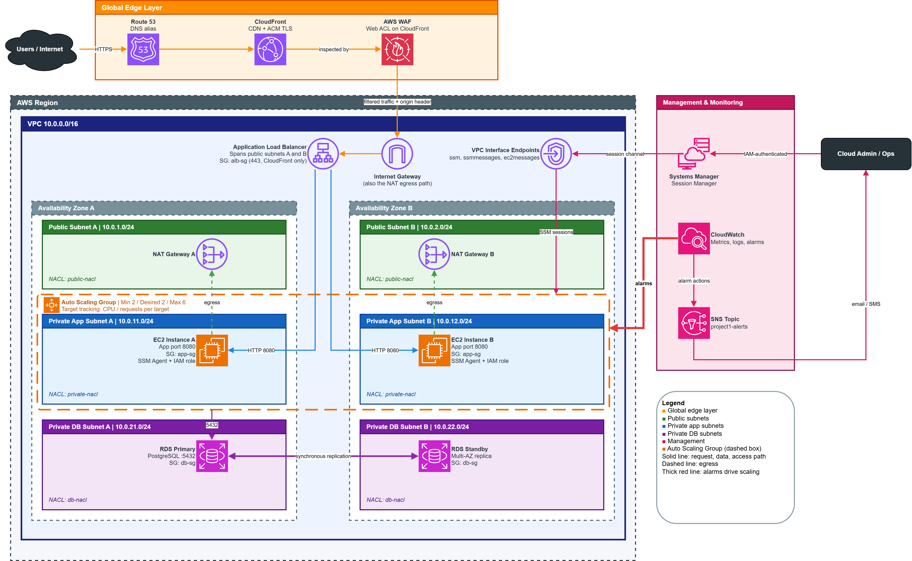

# Scalable Web Application with ALB and Auto Scaling

A practical AWS deployment of a Node.js web application using an Application Load Balancer, EC2 Auto Scaling, private application and database subnets, Amazon RDS for PostgreSQL, CloudFront, AWS WAF, Systems Manager Session Manager, CloudWatch, and SNS.

> **Deployment status:** This README documents the resources currently deployed in **US East (N. Virginia) — `us-east-1`**. It distinguishes implemented components from design items that are not yet deployed. This is important because the live environment uses a single NAT Gateway and a Single-AZ RDS database to control cost.

## Table of Contents

- [Architecture Diagram](#architecture-diagram)
- [Architecture Overview](#architecture-overview)
- [Network Design](#network-design)
- [Security Posture](#security-posture)
- [Monitoring](#monitoring)
- [Application](#application)
- [Deployment Steps](#deployment-steps)
- [Validation and Testing](#validation-and-testing)
- [Known Limitations and Next Steps](#known-limitations-and-next-steps)
- [Cost Considerations](#cost-considerations)

---

## Architecture Diagram



Editable diagram source: [`docs/architecture.drawio`](docs/architecture.drawio) (open with [diagrams.net](https://app.diagrams.net/)).

**Diagram status:** The diagram is the original target-design illustration and may still show planned components that differ from the deployed environment. Use the as-built details in this README as the source of truth. The diagram should be updated to match the current deployment before being treated as an exact as-built diagram.

---

## Architecture Overview

The deployed request path is:

```text
Browser --HTTPS--> CloudFront --HTTP origin--> Application Load Balancer
                                      |
                                      v
                              EC2 Auto Scaling Group
                                      |
                                      v
                               RDS PostgreSQL
```

A Regional AWS WAF web ACL is associated with the Application Load Balancer. CloudFront provides HTTPS for viewers and caching. The ALB forwards HTTP traffic to EC2 instances on port `8080`. The EC2 instances run in private application subnets across two Availability Zones and connect to a private PostgreSQL database.

### Design Goals and Implementation

| Goal | Current implementation |
| --- | --- |
| High availability for application compute | ASG spans two Availability Zones, with minimum and desired capacity of 2 |
| Horizontal scaling | CPU target tracking at 50% and a step scale-out policy for high CPU |
| Load balancing | Internet-facing ALB across two public subnets |
| Private application tier | EC2 instances have no public IP; inbound app traffic is allowed from the ALB security group |
| Private database tier | RDS is not publicly accessible and accepts PostgreSQL traffic from the app security group |
| Web request filtering | Regional AWS WAF attached to the ALB |
| CDN and viewer encryption | CloudFront redirects viewer HTTP to HTTPS and caches the default behavior |
| Secure administration | SSM Session Manager; no SSH key pair or inbound SSH rule |
| Monitoring and alerting | CloudWatch dashboard and alarms with SNS email notifications |

### Core Components

| Layer | AWS service | Deployed responsibility |
| --- | --- | --- |
| DNS | Amazon Route 53 | Public hosted zone and ALB health check; domain delegation and alias routing are not complete yet |
| CDN | Amazon CloudFront | HTTPS viewer access, static/default caching, and forwarding to the ALB origin |
| Web protection | AWS WAF | Regional managed rule groups associated with the ALB |
| Load balancing | Application Load Balancer | Public entry point; forwards HTTP traffic to the target group |
| Compute | EC2 Auto Scaling Group | Two private EC2 instances across two Availability Zones |
| Database | Amazon RDS for PostgreSQL | Private Single-AZ database |
| Secrets | AWS Secrets Manager | Stores application database credentials |
| Administration | AWS Systems Manager Session Manager | Private instance access without SSH |
| Monitoring | Amazon CloudWatch | Dashboard, metrics, and alarms |
| Notifications | Amazon SNS | Delivers CloudWatch alarm notifications by email |

### Auto Scaling Behavior

The Auto Scaling Group uses the Launch Template and spans the two private application subnets.

- Minimum capacity: **2**
- Desired capacity: **2**
- Maximum capacity: **4**
- Target tracking: average ASG CPU utilization target of **50%**
- Step scale-out: adds one instance when the high-CPU alarm reaches its configured threshold
- Health checks: EC2 and Elastic Load Balancing health checks are enabled
- Target group health endpoint: `/health`

A scale-out test caused the group to increase from two instances to four. The target tracking policy subsequently scaled the group back down.

---

## Network Design

### VPC

| Property | Deployed value |
| --- | --- |
| VPC name | `scalable-webapp-vpc` |
| IPv4 CIDR | `10.20.0.0/16` |
| Region | `us-east-1` |
| Availability Zones | `us-east-1a`, `us-east-1b` |
| DNS support / hostnames | Enabled |
| Subnet tiers | Public, private application, private database |

### Subnet Layout

| Subnet | CIDR | Availability Zone | Purpose |
| --- | --- | --- | --- |
| `public-a` | `10.20.1.0/24` | `us-east-1a` | ALB and NAT Gateway |
| `public-b` | `10.20.2.0/24` | `us-east-1b` | ALB |
| `app-private-a` | `10.20.11.0/24` | `us-east-1a` | Private EC2 instances |
| `app-private-b` | `10.20.12.0/24` | `us-east-1b` | Private EC2 instances |
| `db-private-a` | `10.20.21.0/24` | `us-east-1a` | RDS subnet group |
| `db-private-b` | `10.20.22.0/24` | `us-east-1b` | RDS subnet group |

The database subnet group contains both private database subnets. The current RDS deployment itself is Single-AZ.

### Routing

- The public route table has a local VPC route and a default route to the Internet Gateway. Both public subnets use it.
- Both private application subnets use a shared route table with a default route to the NAT Gateway in `public-a`.
- The private database subnets use database route tables with local VPC routing only; they have no default internet route.
- **One NAT Gateway is deployed**, in `public-a`, and is shared by both application subnets.

Using one NAT Gateway reduces the fixed cost compared with deploying one per Availability Zone. It also creates an Availability Zone dependency for outbound internet access and can result in cross-AZ data transfer for instances in the other AZ.

### Network ACLs

The default network ACL remains associated with the public and application subnets. A custom NACL named `scalable-webapp-db-nacl` is associated with both database subnets.

The custom database NACL allows:

| Direction | Protocol / ports | Source or destination | Action |
| --- | --- | --- | --- |
| Inbound | TCP 5432 | `10.20.11.0/24` | Allow |
| Inbound | TCP 5432 | `10.20.12.0/24` | Allow |
| Outbound | TCP 1024–65535 | `10.20.11.0/24` | Allow |
| Outbound | TCP 1024–65535 | `10.20.12.0/24` | Allow |
| Inbound / outbound | All other traffic | Any | Denied by the default `*` rule |

The outbound ephemeral-port rules allow database response traffic to return to the application instances. NACLs are stateless, so both directions must be considered.

### Security Groups

| Security group | Attached resource | Inbound rule |
| --- | --- | --- |
| `scalable-webapp-alb-sg` | Application Load Balancer | TCP 80 and 443 from `0.0.0.0/0` |
| `scalable-webapp-app-sg` | EC2 Auto Scaling instances | TCP 8080 from the ALB security group only |
| `scalable-webapp-db-sg` | RDS PostgreSQL | TCP 5432 from the application security group only |

The ALB currently has an HTTP listener on port 80. The security group also permits port 443, but an ALB HTTPS listener has not yet been configured.

### Private Connectivity for Systems Manager

EC2 instances use an IAM instance profile with `AmazonSSMManagedInstanceCore`. Session Manager access is working through outbound connectivity via the NAT Gateway.

**VPC interface endpoints for SSM are not deployed.** The instances do not require inbound SSH access or a public IP address.

---

## Security Posture

The deployment uses multiple layers of network and application security:

| Layer | Current control |
| --- | --- |
| Viewer connection | CloudFront viewer protocol policy redirects HTTP to HTTPS |
| Web filtering | Regional AWS WAF web ACL associated with the ALB |
| Application ingress | EC2 security group accepts TCP 8080 only from the ALB security group |
| Compute isolation | EC2 instances run in private subnets without public IP addresses |
| Database isolation | RDS is private; port 5432 is allowed from the application security group |
| Database credentials | Application credentials are stored in Secrets Manager and retrieved by the EC2 instance role |
| Database transport | Application-to-RDS connection uses TLS with certificate verification |
| Instance administration | SSM Session Manager; no inbound SSH rule or key pair |
| Metadata access | Application uses the EC2 Instance Metadata Service v2 |

### AWS WAF

The deployed web ACL is **Regional** and associated with the Application Load Balancer. It is not the CloudFront-scope web ACL.

The web ACL includes these AWS managed rule groups, configured with Block actions:

- `AWSManagedRulesCommonRuleSet` — common web exploits
- `AWSManagedRulesKnownBadInputsRuleSet` — known malicious input patterns
- `AWSManagedRulesSQLiRuleSet` — SQL injection patterns

A separate CloudFront-created web ACL exists in the account; it is not the Regional web ACL described above. No custom rate-based rule is currently configured on the Regional web ACL.

WAF blocks matching requests at the ALB. A blocked request is not, by itself, proof of a confirmed attack; managed rules can also block malformed or unexpected requests.

### Systems Manager Session Manager

The EC2 instances are managed through AWS Systems Manager. The instance role includes `AmazonSSMManagedInstanceCore`, and the instances use NAT egress to reach the Systems Manager service.

This avoids opening inbound SSH (port 22) and avoids maintaining a public bastion host.

### Database Protection

- RDS is configured with public access disabled.
- The database security group accepts PostgreSQL traffic only from the application security group.
- Database storage encryption is enabled.
- Application credentials are stored in Secrets Manager; they are not embedded in the repository.
- The application connects to PostgreSQL over TLS and verifies the RDS certificate.

---

## Monitoring

CloudWatch and SNS provide operational visibility and alert delivery.

### CloudWatch Dashboard

The dashboard `scalable-webapp-dashboard` contains widgets for:

- Auto Scaling Group average CPU utilization
- Healthy target count for the ALB target group
- Unhealthy target count for the ALB target group

### Scaling and Alarm Configuration

| Alarm / policy | Metric or condition | Action |
| --- | --- | --- |
| CPU target tracking | ASG average CPU target: 50% | Automatically adjusts ASG capacity |
| High CPU step scaling | CPU at or above 70% for two evaluation periods | Adds one instance |
| High CPU notification | ASG average CPU at or above 70% for two evaluation periods | Sends SNS notification |
| Unhealthy targets | Unhealthy target count at or above 1 for two evaluation periods | Sends SNS notification |
| ALB 5XX errors | ALB-generated 5XX count at or above 5 for two evaluation periods | Sends SNS notification |

The ALB 5XX alarm may show **Insufficient Data** when there have not been enough ALB-generated 5XX requests to evaluate the condition. This is not the same as an alarm state.

Target tracking also creates and manages its own CloudWatch alarms. Those service-managed alarms are separate from the custom notification alarms listed above.

### SNS Notifications

The SNS topic `scalable-webapp-alerts` has a confirmed email subscription. A test notification was received successfully.

---

## Application

The repository contains a Node.js service built with Express and PostgreSQL.

- Application source and local setup: [`app/README.md`](app/README.md)
- EC2 user data: [`deploy/user-data.sh`](deploy/user-data.sh)
- systemd service: [`deploy/project1-app.service`](deploy/project1-app.service)

### Application Endpoints

| Method | Path | Purpose |
| --- | --- | --- |
| GET | `/` | Status page and task list |
| GET | `/health` | ALB health check; does not depend on database availability |
| GET | `/health/ready` | Checks database readiness |
| GET | `/api/info` | Returns instance ID, Availability Zone, uptime, and database status |
| GET | `/api/tasks` | Lists tasks |
| POST | `/api/tasks` | Creates a task |
| PATCH | `/api/tasks/:id` | Updates task completion |
| DELETE | `/api/tasks/:id` | Deletes a task |

The application runs on port `8080`. The ALB target group uses `/health` for health checks. The endpoint intentionally does not query the database, preventing a database issue from causing healthy EC2 instances to be replaced unnecessarily.

### Database Configuration

The application connects to the private RDS PostgreSQL database using the application database user. The EC2 instance role is allowed to retrieve the relevant database secret from Secrets Manager. The application verifies the RDS TLS certificate.

Do not commit database passwords, secret values, private keys, or other credentials to this repository.

---

## Deployment Steps

The environment was created through the AWS Management Console. The following is a high-level record of the deployed build order, not a claim that the repository currently provisions the infrastructure automatically.

1. **Networking:** Create the VPC, six subnets, Internet Gateway, route tables, one NAT Gateway, and database NACL.
2. **Security:** Create the ALB, application, and database security groups. Restrict application and database ingress to the relevant security groups.
3. **Database:** Create the private RDS PostgreSQL instance and DB subnet group. Store application credentials in Secrets Manager.
4. **Instance access:** Create the EC2 IAM role and instance profile with Systems Manager permissions and access to the application database secret.
5. **Application image:** Prepare the Amazon Linux 2023 application AMI with Node.js, the application, systemd service, and RDS CA bundle.
6. **Load balancing:** Create the target group on HTTP port 8080 with the `/health` health check, then create the internet-facing ALB in both public subnets.
7. **Auto Scaling:** Create the Launch Template and the Auto Scaling Group across both private application subnets. Attach the target group and configure target tracking and step scaling.
8. **Web protection:** Create the Regional WAF web ACL with the three AWS managed rule groups and associate it with the ALB.
9. **CDN:** Create the CloudFront distribution with the ALB as an HTTP origin. Configure HTTPS redirection for viewers and separate cache behavior for API and health paths.
10. **Operations:** Create the CloudWatch dashboard, custom alarms, SNS topic, and confirmed email subscription.
11. **DNS:** Create the Route 53 public hosted zone and ALB health check. The custom domain's nameserver delegation still needs to be completed before the domain can be used reliably.

### CloudFront Distribution

The current distribution uses the CloudFront-provided domain name:

- Distribution domain: [`https://d3hubbfv49ch29.cloudfront.net`](https://d3hubbfv49ch29.cloudfront.net)
- Health endpoint: [`/health`](https://d3hubbfv49ch29.cloudfront.net/health)
- Instance and database information: [`/api/info`](https://d3hubbfv49ch29.cloudfront.net/api/info)

Viewer requests use HTTPS. The CloudFront-to-ALB origin connection currently uses HTTP on port 80; an HTTPS listener and origin TLS configuration have not yet been deployed.

---

## Validation and Testing

The following behaviors have been tested in the deployed environment:

| Test | Result |
| --- | --- |
| Application health endpoint | `/health` returned HTTP 200 through CloudFront |
| Application readiness | `/health/ready` returned successfully when RDS was available |
| End-to-end application path | CloudFront → ALB → EC2 → RDS verified |
| Database connectivity | Application API reported `database: true` |
| TLS to RDS | Application-to-RDS TLS connection verified using the RDS CA bundle |
| Multi-AZ compute placement | Two ASG instances confirmed in separate Availability Zones |
| Auto Scaling self-healing | Terminating an ASG instance caused a replacement to launch and become healthy |
| Step scaling | High CPU test caused the ASG to scale from two to four instances |
| Target tracking | ASG later scaled back down toward its desired baseline |
| WAF | Managed rule groups are in Block mode; WAF metrics showed both allowed and blocked requests |
| CloudWatch / SNS | Dashboard and alarms created; SNS test email received |
| Session Manager | Connected to private EC2 instances without SSH |
| Database NACL | Application-to-RDS connectivity remained successful after custom DB NACL association |
| Route 53 health check | ALB health check reached Healthy state |

---

## Known Limitations and Next Steps

These items are not represented as completed features:

1. **RDS is Single-AZ.** The DB subnet group spans two Availability Zones, but the current database deployment does not have a Multi-AZ standby or automatic Multi-AZ failover.
2. **One NAT Gateway is deployed.** It is a cost-saving configuration, not a fully AZ-resilient NAT design.
3. **ALB HTTPS is not configured.** The ALB currently has an HTTP listener on port 80. CloudFront uses HTTPS for viewer connections but connects to the ALB over HTTP.
4. **Custom domain delegation is pending.** The Route 53 hosted zone and health check exist, but the parent DNS delegation for the DNSExit subdomain has not yet been verified. The Route 53 alias record for the custom domain is therefore not considered live.
5. **WAF is Regional and attached to the ALB.** The deployed web ACL is not attached to CloudFront, and no custom rate-based rule is configured.
6. **SSM VPC endpoints are not deployed.** Session Manager currently reaches the service through NAT egress.
7. **Custom NACLs are applied only to the database subnets.** Public and application subnets still use the default NACL.
8. **ALB origin access is not restricted to CloudFront.** The ALB security group currently permits inbound TCP 80 and 443 from the internet. The application instances remain restricted to traffic from the ALB security group.

Recommended follow-up work is to complete DNS delegation, request and validate an ACM certificate for the custom domain, add an ALB HTTPS listener, configure CloudFront to use HTTPS to the origin, review the ALB ingress restriction strategy, update the architecture diagram to match the deployed resources, and enable Multi-AZ RDS if the project budget allows.

---

## Cost Considerations

This is a working AWS environment and several resources incur charges while running, even when there is little or no application traffic.

| Component | Main cost driver | Current cost-conscious choice |
| --- | --- | --- |
| NAT Gateway | Hourly charge and data processed | One NAT Gateway shared by both app subnets |
| EC2 | Instance hours and EBS volumes | Two `t3.micro` instances at the normal desired capacity |
| RDS PostgreSQL | Database instance hours, storage, backups | Single-AZ deployment |
| Application Load Balancer | ALB hours and capacity units | One ALB |
| CloudFront | Requests and data transfer to viewers | Default distribution domain and caching |
| AWS WAF | Web ACL, managed rules, and inspected requests | Three managed rule groups |
| CloudWatch | Alarms, metrics, and log ingestion/storage | Dashboard and a limited set of alarms |
| Route 53 | Hosted zone, queries, and health check | One hosted zone and one health check |
| Secrets Manager | Secret storage and API calls | Application database secret |

For a portfolio or learning environment, review AWS Billing and Cost Explorer regularly. Stop or delete resources that are no longer needed, especially the NAT Gateway, RDS instance, ALB, and running EC2 instances. Before deleting resources, confirm whether any data or configuration must be retained.

For cost estimates, use the [AWS Pricing Calculator](https://calculator.aws/) with the selected Region and actual usage assumptions.
