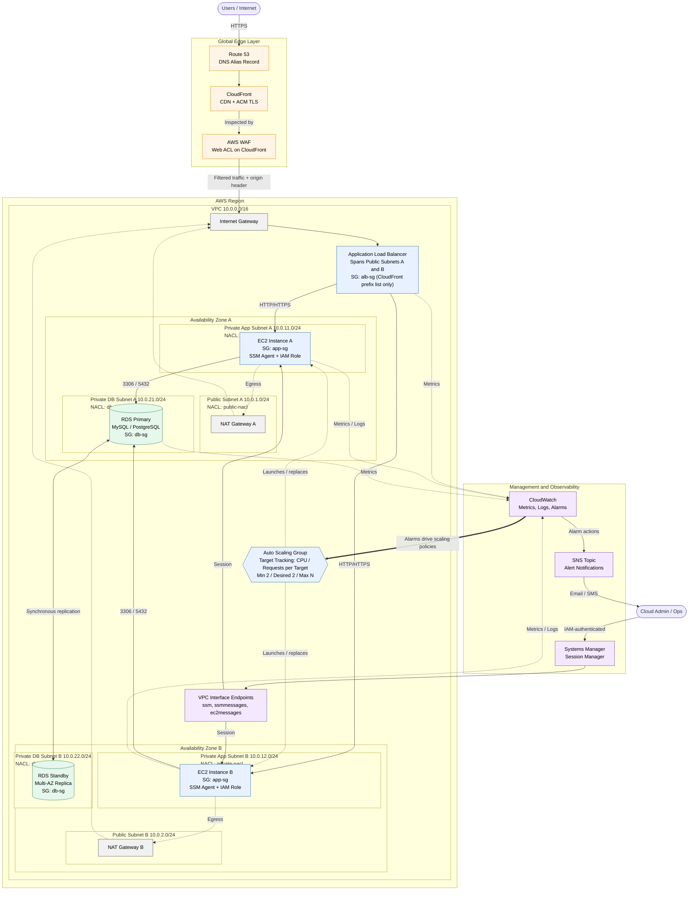
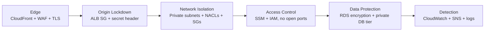
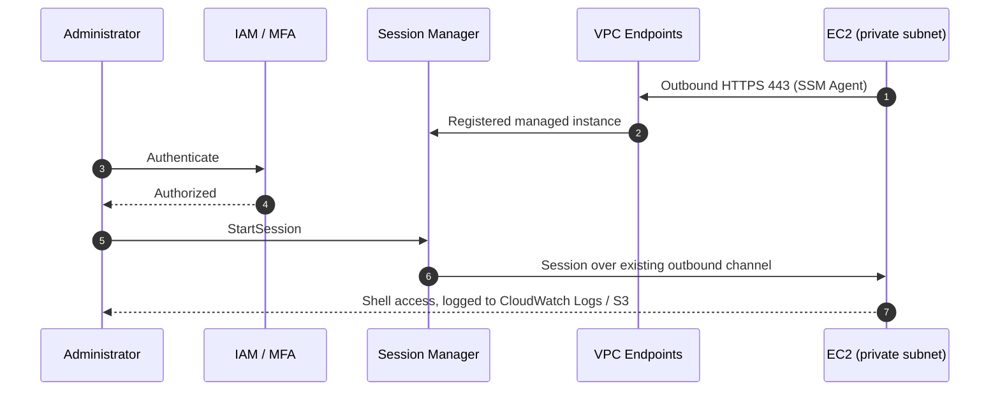

# AWS-Scalable-Web-App-Project

# Project 1: Scalable Web Application with ALB and Auto Scaling

## Architecture Diagram



## Legend

| Line style | Meaning |
| --- | --- |
| Solid arrow | Primary request, data, or access path |
| Dotted arrow | Control plane, egress, or telemetry |
| Thick arrow | CloudWatch alarms triggering Auto Scaling |


## Architecture Overview

This project deploys a highly available, horizontally scalable web application on AWS. Traffic enters through a global edge layer, is filtered by AWS WAF, and is served by an Auto Scaling fleet of EC2 instances in private subnets behind an Application Load Balancer. Persistent data lives in a Multi-AZ RDS database that is never exposed to the internet.

### Design Goals

| Goal | How it is achieved |
| --- | --- |
| **High availability** | Two Availability Zones for every tier; Multi-AZ RDS with automatic failover |
| **Elastic scalability** | Auto Scaling Group with target tracking policies |
| **Security in depth** | WAF at the edge, ALB locked to CloudFront, private compute and data tiers, layered NACLs and Security Groups |
| **No inbound admin access** | SSM Session Manager replaces SSH and bastion hosts |
| **Observability** | CloudWatch metrics, logs, and alarms, with SNS notifications |

### Request Flow

```text
Route 53 -> CloudFront -> WAF -> Application Load Balancer -> EC2 (Auto Scaling Group) -> RDS (Multi-AZ)
```

1. **Route 53** resolves the application domain to the CloudFront distribution through an alias record.
2. **CloudFront** terminates TLS at the edge, caches cacheable content, and forwards the remaining requests to the origin.
3. **AWS WAF** is attached to the CloudFront distribution and evaluates every request against managed rule groups and rate limits.
4. **The Application Load Balancer** sits in the public subnets and accepts traffic only from CloudFront (see [Security Groups](#security-groups)).
5. **EC2 instances** in the Auto Scaling Group run the application in private subnets and receive traffic from the ALB only.
6. **Amazon RDS** (MySQL or PostgreSQL, Multi-AZ) stores application data in dedicated private database subnets.

### Core Components

| Layer | Service | Responsibility |
| --- | --- | --- |
| DNS | Amazon Route 53 | Domain resolution and alias routing to CloudFront |
| Edge | Amazon CloudFront | CDN, TLS termination, origin shielding |
| Protection | AWS WAF | Layer 7 filtering, managed rules, rate limiting |
| Load balancing | Application Load Balancer | Cross-AZ request distribution and health checks |
| Compute | EC2 Auto Scaling Group | Self-healing, elastic application fleet |
| Data | Amazon RDS Multi-AZ | Synchronous standby replica and automatic failover |
| Access | AWS Systems Manager Session Manager | IAM-authenticated shell access with no open ports |
| Monitoring | Amazon CloudWatch | Metrics, logs, alarms, and scaling triggers |
| Alerting | Amazon SNS | Alarm notifications via email or SMS |

### Auto Scaling Behavior

The Auto Scaling Group spans the private application subnets in both Availability Zones and is launched from a Launch Template. **Target tracking policies** keep a chosen metric near its target value, for example average CPU utilization or ALB request count per target. ALB health checks mark unhealthy instances for replacement, so the fleet recovers without manual intervention.

---

## Network Design

### VPC

| Property | Value |
| --- | --- |
| VPC CIDR | `10.0.0.0/16` |
| Availability Zones | 2 (AZ A and AZ B) |
| DNS support / hostnames | Enabled |
| Subnet tiers | Public, Private (application), Private (database) |

> **Note:** Replace `AZ A` and `AZ B` with the actual zone names for your chosen region (for example, `<region>a` and `<region>b`). The CIDR ranges below are the project defaults and can be changed to fit your address plan.

### Subnet Layout

| Subnet Name | CIDR Block | Availability Zone | Type | Hosts |
| --- | --- | --- | --- | --- |
| `project1-public-a` | `10.0.1.0/24` | AZ A | Public | ALB node, NAT Gateway |
| `project1-public-b` | `10.0.2.0/24` | AZ B | Public | ALB node, NAT Gateway |
| `project1-private-app-a` | `10.0.11.0/24` | AZ A | Private | EC2 (Auto Scaling Group) |
| `project1-private-app-b` | `10.0.12.0/24` | AZ B | Private | EC2 (Auto Scaling Group) |
| `project1-private-db-a` | `10.0.21.0/24` | AZ A | Private | RDS primary |
| `project1-private-db-b` | `10.0.22.0/24` | AZ B | Private | RDS standby |

Each `/24` provides 251 usable addresses, since AWS reserves five per subnet.

### Routing

| Route Table | Associated Subnets | Destination | Target |
| --- | --- | --- | --- |
| `project1-rt-public` | `public-a`, `public-b` | `10.0.0.0/16` | local |
|  |  | `0.0.0.0/0` | Internet Gateway |
| `project1-rt-private-app-a` | `private-app-a` | `10.0.0.0/16` | local |
|  |  | `0.0.0.0/0` | NAT Gateway in `public-a` |
| `project1-rt-private-app-b` | `private-app-b` | `10.0.0.0/16` | local |
|  |  | `0.0.0.0/0` | NAT Gateway in `public-b` |
| `project1-rt-private-db` | `private-db-a`, `private-db-b` | `10.0.0.0/16` | local only |

- One NAT Gateway per Availability Zone keeps outbound access (patching, package installs) available if a zone fails.
- Database subnets have **no route to the internet** in either direction.

### Network ACLs

NACLs are stateless, so return traffic must be allowed explicitly on ephemeral ports (`1024-65535`).

| NACL | Applied To | Inbound | Outbound |
| --- | --- | --- | --- |
| `public-nacl` | Public subnets | `80` and `443` from `0.0.0.0/0`; ephemeral ports from `0.0.0.0/0` | `80` and `443` to `0.0.0.0/0`; ephemeral ports to `0.0.0.0/0`; application port to app subnets |
| `private-nacl` | Private app subnets | Application port from public subnets; ephemeral ports from `0.0.0.0/0` (NAT return traffic) | `443` to `0.0.0.0/0`; DB port to DB subnets; ephemeral ports to public subnets |
| `db-nacl` | Private DB subnets | DB port (`3306` or `5432`) from app subnets | Ephemeral ports to app subnets |

### Security Groups

Security Groups are stateful and reference one another instead of IP ranges wherever possible.

| Security Group | Attached To | Inbound Rule | Source |
| --- | --- | --- | --- |
| `alb-sg` | Application Load Balancer | `443` | CloudFront origin-facing managed prefix list |
| `app-sg` | EC2 instances | Application port | `alb-sg` |
| `db-sg` | RDS instances | `3306` (MySQL) or `5432` (PostgreSQL) | `app-sg` |
| `vpce-sg` | SSM interface endpoints | `443` | `app-sg` |

Prefix list name: `com.amazonaws.global.cloudfront.origin-facing`. For defense in depth, configure CloudFront to add a secret custom header to origin requests and have the ALB listener reject any request without it.

### Private Connectivity for Systems Manager

EC2 instances use SSM Session Manager for administration, with no inbound ports and no bastion host. To keep this traffic off the public internet, the VPC includes interface endpoints for:

- `com.amazonaws.<region>.ssm`
- `com.amazonaws.<region>.ssmmessages`
- `com.amazonaws.<region>.ec2messages`

Instances need an IAM instance profile that includes the `AmazonSSMManagedInstanceCore` policy.


## Security Posture

Security is layered so that no single control is a point of failure. Requests are filtered at the edge, the origin accepts traffic only from that edge, compute and data live in private subnets, and administrative access is identity-based rather than network-based.



### Defense-in-Depth Summary

| Layer | Control | Purpose |
| --- | --- | --- |
| Edge | CloudFront with HTTPS-only viewer policy and TLS 1.2+ | Encrypts traffic in transit and absorbs volumetric load |
| Application filtering | AWS WAF web ACL on CloudFront | Blocks malicious requests before they reach the VPC |
| Origin protection | `alb-sg` allows only the CloudFront prefix list, plus a secret origin header | Prevents bypassing WAF by calling the ALB directly |
| Network | Private subnets, NACLs, Security Groups | Limits lateral movement and exposure |
| Access | SSM Session Manager, no inbound SSH or RDP | Removes the bastion attack surface |
| Data | Multi-AZ RDS in isolated subnets, encryption at rest (KMS) | Keeps data off the internet and encrypted |
| Instance hardening | IMDSv2 required, least-privilege instance role | Mitigates credential theft through SSRF |
| Detection | CloudWatch, SNS, WAF logs, CloudTrail, VPC Flow Logs | Provides visibility and alerting |

### AWS WAF and the OWASP Top 10

AWS WAF is attached to the CloudFront distribution (scope `CLOUDFRONT`, created in `us-east-1`) and evaluates every request before it is forwarded to the ALB. The web ACL combines AWS Managed Rule Groups with custom rate-based rules.

#### Recommended Web ACL Rules

| Priority | Rule Group | Protects Against |
| --- | --- | --- |
| 1 | `AWSManagedRulesAmazonIpReputationList` | Requests from IPs associated with known malicious activity |
| 2 | `AWSManagedRulesCommonRuleSet` | Common web exploits, including XSS, path traversal, and SSRF patterns |
| 3 | `AWSManagedRulesKnownBadInputsRuleSet` | Exploit patterns for known vulnerabilities (for example Log4j) |
| 4 | `AWSManagedRulesSQLiRuleSet` | SQL injection attempts |
| 5 | `AWSManagedRulesAdminProtectionRuleSet` | External access to administrative paths |
| 6 | Custom rate-based rule | Brute force, credential stuffing, and request floods per IP |

Optional paid rule groups, such as Bot Control and Account Takeover Prevention, can be added for login-heavy applications.

> **Rollout tip:** Deploy new rules in **Count** mode first, review the WAF logs for false positives, then switch them to **Block**.

#### Coverage Mapped to the OWASP Top 10 (2021)

WAF reduces exposure to several categories directly and contributes to others. It does not replace secure application code.

| OWASP Category | WAF Contribution | Other Controls in This Design |
| --- | --- | --- |
| A01 Broken Access Control | Partial: admin-path protection and custom path rules | Application authorization logic, least-privilege IAM |
| A02 Cryptographic Failures | Indirect | HTTPS-only CloudFront, TLS 1.2+, RDS encryption at rest |
| A03 Injection | **Strong**: SQLi and Common rule sets, known bad inputs | Parameterized queries in the application |
| A04 Insecure Design | None | Threat modeling and design review |
| A05 Security Misconfiguration | Indirect | Private subnets, Security Groups, NACLs, SSM, AWS Config |
| A06 Vulnerable and Outdated Components | Partial: virtual patching for known exploits | Patch management with SSM Patch Manager, dependency scanning |
| A07 Identification and Authentication Failures | Partial: rate limiting, IP reputation | Application MFA and session management |
| A08 Software and Data Integrity Failures | Limited | CI/CD signing and integrity checks |
| A09 Security Logging and Monitoring Failures | Supports: WAF request logging | CloudWatch, CloudTrail, VPC Flow Logs, SNS alerts |
| A10 Server-Side Request Forgery | Partial: SSRF patterns in the Common rule set | IMDSv2 enforced, restrictive egress |

> The OWASP Top 10 is revised periodically. If you reference a newer edition, re-map the categories above.

#### WAF Logging

Enable WAF logging to a CloudWatch Logs group (the name must start with `aws-waf-logs-`), S3, or Kinesis Data Firehose. Redact sensitive headers such as `Authorization` and `Cookie`. These logs support tuning rules and investigating incidents.

### Eliminating the Bastion Host with SSM Session Manager

A traditional bastion host is a public-facing server with open SSH or RDP ports, key management overhead, and its own patching burden. This design removes it entirely. Administrators use **AWS Systems Manager Session Manager** to open shell sessions to instances that have no public IP and no inbound administrative ports.

#### How It Works

1. The SSM Agent on each EC2 instance makes an **outbound** HTTPS (`443`) connection to the Systems Manager service, through VPC interface endpoints (`ssm`, `ssmmessages`, `ec2messages`).
2. An administrator authenticates with IAM (and MFA if enforced) and starts a session through the console or the AWS CLI.
3. Systems Manager brokers the session over the existing outbound channel. **No inbound port is ever opened.**



#### Bastion Host vs. Session Manager

| Concern | EC2 Bastion Host | SSM Session Manager |
| --- | --- | --- |
| Inbound ports | Port `22` or `3389` open | None |
| Public IP required | Yes | No |
| Authentication | SSH keys (distribution and rotation) | IAM identities with optional MFA |
| Audit trail | Manual configuration | CloudTrail records `StartSession`; session output can be logged to CloudWatch Logs or S3 |
| Extra infrastructure to patch | Yes | No |
| Cost | Instance running 24/7 | No additional charge for Session Manager itself |
| Fine-grained access | Network-level | IAM policies, including tag-based conditions |

#### Requirements

- Instance profile with the `AmazonSSMManagedInstanceCore` managed policy.
- SSM Agent running (preinstalled on current Amazon Linux AMIs).
- Interface endpoints for `ssm`, `ssmmessages`, and `ec2messages`, or outbound access through the NAT Gateways.
- Session logging enabled in Session Manager preferences.
- For CLI access, the Session Manager plugin installed locally.

```bash
aws ssm start-session --target <instance-id>
```

For one-off database administration, use SSM port forwarding to reach RDS through an instance in the private subnets instead of exposing the database:

```bash
aws ssm start-session \
  --target <instance-id> \
  --document-name AWS-StartPortForwardingSessionToRemoteHost \
  --parameters host="<rds-endpoint>",portNumber="<db-port>",localPortNumber="<local-port>"
```

---

## Monitoring

Monitoring in this project serves two purposes: **drive automatic scaling decisions** and **notify humans when something needs attention**. CloudWatch collects and evaluates the metrics, and SNS delivers the notifications.

### Monitoring Architecture


### How Scaling Works

The Auto Scaling Group uses **target tracking scaling policies** (for example, average CPU near 50% or ALB request count per target at a chosen value).

- Target tracking **creates and manages its own CloudWatch alarms** (one for scale-out, one for scale-in). Do not edit or delete them manually.
- When the tracked metric moves away from the target, the ASG adds or removes instances automatically.
- Scale-out reacts quickly; scale-in is deliberately conservative to avoid flapping. Configure an instance warmup period so new instances are not counted before they are ready.

### How Alerts Work

Scaling happens without human involvement, so alerts focus on **visibility** (what scaled and when) and **problems** (scaling cannot keep up or something is failing).

#### 1. Scaling Event Notifications

Configure the ASG to publish notifications to the `project1-alerts` SNS topic for:

| Event | Meaning |
| --- | --- |
| `autoscaling:EC2_INSTANCE_LAUNCH` | A scale-out or replacement launched an instance |
| `autoscaling:EC2_INSTANCE_TERMINATE` | A scale-in or health replacement terminated an instance |
| `autoscaling:EC2_INSTANCE_LAUNCH_ERROR` | Launch failed (capacity, quota, or Launch Template issue) |
| `autoscaling:EC2_INSTANCE_TERMINATE_ERROR` | Termination failed |

#### 2. Custom CloudWatch Alarms

These alarms do **not** drive scaling. They notify the team through SNS. The thresholds are starting points to tune against real traffic.

| Alarm | Metric (Namespace) | Suggested Condition | Why It Matters |
| --- | --- | --- | --- |
| Fleet at max capacity | `GroupInServiceInstances` vs. `GroupMaxSize` (`AWS/AutoScaling`, group metrics enabled) | In-service count equals max for 10+ minutes | Scaling can no longer absorb load |
| Unhealthy targets | `UnHealthyHostCount` (`AWS/ApplicationELB`) | Greater than 0 for 5 minutes | Instances failing health checks |
| ALB 5XX errors | `HTTPCode_Target_5XX_Count` (`AWS/ApplicationELB`) | Above baseline for 5 minutes | Application errors |
| Slow responses | `TargetResponseTime` (`AWS/ApplicationELB`) | p95 above target for 5 minutes | Degraded user experience |
| RDS CPU | `CPUUtilization` (`AWS/RDS`) | Above 80% for 10 minutes | Database saturation |
| RDS storage | `FreeStorageSpace` (`AWS/RDS`) | Below a chosen free-space threshold | Prevents storage exhaustion |
| RDS connections | `DatabaseConnections` (`AWS/RDS`) | Near the instance connection limit | Connection pool exhaustion |
| CloudFront errors | `5xxErrorRate` (`AWS/CloudFront`) | Above baseline for 5 minutes | Origin or edge issues |
| WAF spike | `BlockedRequests` (`AWS/WAFV2`) | Sudden increase over baseline | Possible attack in progress |

> **Region note:** CloudFront and WAF (CloudFront scope) metrics are published in `us-east-1`. Alarms on those metrics, and the SNS topic they notify, must also be created in `us-east-1`.

#### 3. RDS Event Notifications

Create an RDS event subscription to the SNS topic for **failover**, **failure**, and **low storage** events so that a Multi-AZ failover is never silent.

### SNS Configuration

| Setting | Recommendation |
| --- | --- |
| Topic | `project1-alerts` (consider separate `critical` and `warning` topics as the system grows) |
| Subscriptions | Email and/or SMS; email subscriptions must be **confirmed** by the recipient |
| Encryption | Server-side encryption with KMS. If using a customer managed key, allow CloudWatch to use it in the key policy |
| Access | Topic policy limits publishing to CloudWatch, Auto Scaling, and RDS in this account |

### Logging

| Source | Destination | Notes |
| --- | --- | --- |
| Application and OS logs | CloudWatch Logs | Requires the CloudWatch Agent on EC2, which can be installed and configured through SSM |
| Memory and disk metrics | CloudWatch Metrics | Not collected by default; provided by the CloudWatch Agent |
| SSM session activity | CloudWatch Logs or S3 | Enable in Session Manager preferences |
| WAF requests | CloudWatch Logs, S3, or Firehose | Log group name must start with `aws-waf-logs-` |
| ALB access logs | S3 | Enable on the load balancer |
| VPC Flow Logs | CloudWatch Logs or S3 | Network-level visibility |
| API activity | CloudTrail | Includes `StartSession` events |

Set a retention period on every log group so costs stay predictable.
