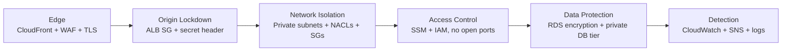
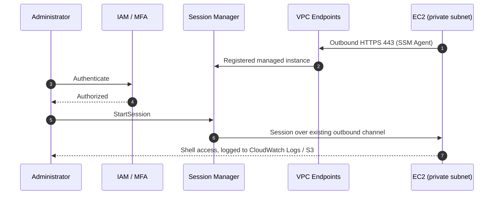
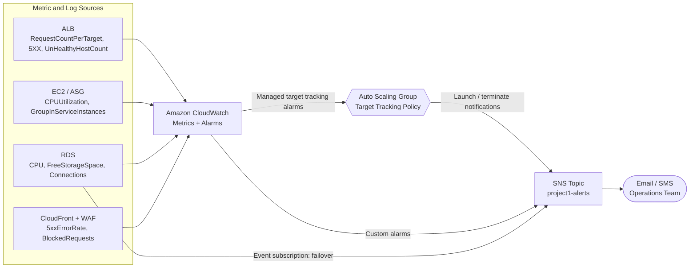

# Project 1: Scalable Web Application with ALB and Auto Scaling

A highly available, horizontally scalable web application on AWS. Traffic flows **Route 53 → CloudFront → WAF → Application Load Balancer → EC2 Auto Scaling Group → Multi-AZ RDS PostgreSQL**, across two Availability Zones, with administrative access through **SSM Session Manager** (no bastion host) and monitoring through **CloudWatch and SNS**.

## Table of Contents

- [Architecture Diagram](#architecture-diagram)
- [Architecture Overview](#architecture-overview)
- [Network Design](#network-design)
- [Security Posture](#security-posture)
- [Monitoring](#monitoring)
- [Deployment Steps](#deployment-steps)
- [Cost Considerations](#cost-considerations)

---

## Architecture Diagram


*Editable source: [`docs/architecture.drawio`](docs/architecture.drawio) (open with [diagrams.net](https://app.diagrams.net/)). The color legend is included in the diagram.*

---

## Architecture Overview

This project deploys a highly available, horizontally scalable web application on AWS. Traffic enters through a global edge layer, is filtered by AWS WAF, and is served by an Auto Scaling fleet of EC2 instances in private subnets behind an Application Load Balancer. Persistent data lives in a Multi-AZ RDS database that is never exposed to the internet.

### Design Goals

| Goal | How it is achieved |
| --- | --- |
| **High availability** | Two Availability Zones for every tier; Multi-AZ RDS with automatic failover |
| **Elastic scalability** | Auto Scaling Group with target tracking policies |
| **Security in depth** | WAF at the edge, ALB locked to CloudFront, private compute and data tiers, layered NACLs and Security Groups |
| **No inbound admin access** | SSM Session Manager replaces SSH and bastion hosts |
| **Observability** | CloudWatch metrics, logs, and alarms, with SNS notifications |

### Request Flow

```text
Route 53 -> CloudFront -> WAF -> Application Load Balancer -> EC2 (Auto Scaling Group) -> RDS (Multi-AZ)
```

1. **Route 53** resolves the application domain to the CloudFront distribution through an alias record.
2. **CloudFront** terminates TLS at the edge, caches cacheable content, and forwards the remaining requests to the origin.
3. **AWS WAF** is attached to the CloudFront distribution and evaluates every request against managed rule groups and rate limits.
4. **The Application Load Balancer** sits in the public subnets and accepts traffic only from CloudFront (see [Security Groups](#security-groups)).
5. **EC2 instances** in the Auto Scaling Group run the application on port `8080` in private subnets and receive traffic from the ALB only.
6. **Amazon RDS** (PostgreSQL, Multi-AZ) stores application data in dedicated private database subnets.

### Core Components

| Layer | Service | Responsibility |
| --- | --- | --- |
| DNS | Amazon Route 53 | Domain resolution and alias routing to CloudFront |
| Edge | Amazon CloudFront | CDN, TLS termination, origin shielding |
| Protection | AWS WAF | Layer 7 filtering, managed rules, rate limiting |
| Load balancing | Application Load Balancer | Cross-AZ request distribution and health checks |
| Compute | EC2 Auto Scaling Group | Self-healing, elastic application fleet |
| Data | Amazon RDS Multi-AZ | Synchronous standby replica and automatic failover |
| Access | AWS Systems Manager Session Manager | IAM-authenticated shell access with no open ports |
| Monitoring | Amazon CloudWatch | Metrics, logs, alarms, and scaling triggers |
| Alerting | Amazon SNS | Alarm notifications via email or SMS |

### Auto Scaling Behavior

The Auto Scaling Group spans the private application subnets in both Availability Zones and is launched from a Launch Template. **Target tracking policies** keep a chosen metric near its target value, for example average CPU utilization or ALB request count per target. ALB health checks mark unhealthy instances for replacement, so the fleet recovers without manual intervention.

---

## Network Design

### VPC

| Property | Value |
| --- | --- |
| VPC CIDR | `10.0.0.0/16` |
| Availability Zones | 2 (AZ A and AZ B) |
| DNS support / hostnames | Enabled |
| Subnet tiers | Public, Private (application), Private (database) |

> **Note:** Replace `AZ A` and `AZ B` with the actual zone names for your chosen region (for example, `<region>a` and `<region>b`). The CIDR ranges below are the project defaults and can be changed to fit your address plan.

### Subnet Layout

| Subnet Name | CIDR Block | Availability Zone | Type | Hosts |
| --- | --- | --- | --- | --- |
| `project1-public-a` | `10.0.1.0/24` | AZ A | Public | ALB node, NAT Gateway |
| `project1-public-b` | `10.0.2.0/24` | AZ B | Public | ALB node, NAT Gateway |
| `project1-private-app-a` | `10.0.11.0/24` | AZ A | Private | EC2 (Auto Scaling Group) |
| `project1-private-app-b` | `10.0.12.0/24` | AZ B | Private | EC2 (Auto Scaling Group) |
| `project1-private-db-a` | `10.0.21.0/24` | AZ A | Private | RDS primary |
| `project1-private-db-b` | `10.0.22.0/24` | AZ B | Private | RDS standby |

Each `/24` provides 251 usable addresses, since AWS reserves five per subnet.

### Routing

| Route Table | Associated Subnets | Destination | Target |
| --- | --- | --- | --- |
| `project1-rt-public` | `public-a`, `public-b` | `10.0.0.0/16` | local |
|  |  | `0.0.0.0/0` | Internet Gateway |
| `project1-rt-private-app-a` | `private-app-a` | `10.0.0.0/16` | local |
|  |  | `0.0.0.0/0` | NAT Gateway in `public-a` |
| `project1-rt-private-app-b` | `private-app-b` | `10.0.0.0/16` | local |
|  |  | `0.0.0.0/0` | NAT Gateway in `public-b` |
| `project1-rt-private-db` | `private-db-a`, `private-db-b` | `10.0.0.0/16` | local only |

- One NAT Gateway per Availability Zone keeps outbound access (patching, package installs) available if a zone fails.
- Database subnets have **no route to the internet** in either direction.

### Network ACLs

NACLs are stateless, so return traffic must be allowed explicitly on ephemeral ports (`1024-65535`). The complete, rule-numbered NACLs are in [Step 3](#step-3-create-and-associate-network-acls) of the deployment runbook.

| NACL | Applied To | Inbound | Outbound |
| --- | --- | --- | --- |
| `public-nacl` | Public subnets | `443` from `0.0.0.0/0`; ephemeral ports (`1024-65535`) from `0.0.0.0/0` | `443` to `0.0.0.0/0`; `8080` to app subnets; ephemeral ports to `0.0.0.0/0` |
| `private-nacl` | Private app subnets | `8080` from public subnets; `443` from private app subnets (endpoint traffic); ephemeral ports from `0.0.0.0/0` (NAT return traffic) | `443` to `0.0.0.0/0`; `5432` to DB subnets; ephemeral ports to public and private app subnets |
| `db-nacl` | Private DB subnets | `5432` from private app subnets | Ephemeral ports to app subnets |

### Security Groups

Security Groups are stateful and reference one another instead of IP ranges wherever possible.

| Security Group | Attached To | Inbound Rule | Source |
| --- | --- | --- | --- |
| `alb-sg` | Application Load Balancer | `443` | CloudFront origin-facing managed prefix list |
| `app-sg` | EC2 instances | `8080` | `alb-sg` |
| `db-sg` | RDS instances | `5432` (PostgreSQL) | `app-sg` |
| `vpce-sg` | SSM interface endpoints | `443` | `app-sg` |

Prefix list name: `com.amazonaws.global.cloudfront.origin-facing`. For defense in depth, configure CloudFront to add a secret custom header to origin requests and have the ALB listener reject any request without it.

### Private Connectivity for Systems Manager

EC2 instances use SSM Session Manager for administration, with no inbound ports and no bastion host. To keep this traffic off the public internet, the VPC includes interface endpoints for:

- `com.amazonaws.<region>.ssm`
- `com.amazonaws.<region>.ssmmessages`
- `com.amazonaws.<region>.ec2messages`

Instances need an IAM instance profile that includes the `AmazonSSMManagedInstanceCore` policy.

---

## Security Posture

Security is layered so that no single control is a point of failure. Requests are filtered at the edge, the origin accepts traffic only from that edge, compute and data live in private subnets, and administrative access is identity-based rather than network-based.



### Defense-in-Depth Summary

| Layer | Control | Purpose |
| --- | --- | --- |
| Edge | CloudFront with HTTPS-only viewer policy and TLS 1.2+ | Encrypts traffic in transit and absorbs volumetric load |
| Application filtering | AWS WAF web ACL on CloudFront | Blocks malicious requests before they reach the VPC |
| Origin protection | `alb-sg` allows only the CloudFront prefix list, plus a secret origin header | Prevents bypassing WAF by calling the ALB directly |
| Network | Private subnets, NACLs, Security Groups | Limits lateral movement and exposure |
| Access | SSM Session Manager, no inbound SSH or RDP | Removes the bastion attack surface |
| Data | Multi-AZ RDS in isolated subnets, encryption at rest (KMS) | Keeps data off the internet and encrypted |
| Instance hardening | IMDSv2 required, least-privilege instance role | Mitigates credential theft through SSRF |
| Detection | CloudWatch, SNS, WAF logs, CloudTrail, VPC Flow Logs | Provides visibility and alerting |

### AWS WAF and the OWASP Top 10

AWS WAF is attached to the CloudFront distribution (scope `CLOUDFRONT`, created in `us-east-1`) and evaluates every request before it is forwarded to the ALB. The web ACL combines AWS Managed Rule Groups with custom rate-based rules.

#### Recommended Web ACL Rules

| Priority | Rule Group | Protects Against |
| --- | --- | --- |
| 1 | `AWSManagedRulesAmazonIpReputationList` | Requests from IPs associated with known malicious activity |
| 2 | `AWSManagedRulesCommonRuleSet` | Common web exploits, including XSS, path traversal, and SSRF patterns |
| 3 | `AWSManagedRulesKnownBadInputsRuleSet` | Exploit patterns for known vulnerabilities (for example Log4j) |
| 4 | `AWSManagedRulesSQLiRuleSet` | SQL injection attempts |
| 5 | `AWSManagedRulesAdminProtectionRuleSet` | External access to administrative paths |
| 6 | Custom rate-based rule | Brute force, credential stuffing, and request floods per IP |

Optional paid rule groups, such as Bot Control and Account Takeover Prevention, can be added for login-heavy applications.

> **Rollout tip:** Deploy new rules in **Count** mode first, review the WAF logs for false positives, then switch them to **Block**.

#### Coverage Mapped to the OWASP Top 10 (2021)

WAF reduces exposure to several categories directly and contributes to others. It does not replace secure application code.

| OWASP Category | WAF Contribution | Other Controls in This Design |
| --- | --- | --- |
| A01 Broken Access Control | Partial: admin-path protection and custom path rules | Application authorization logic, least-privilege IAM |
| A02 Cryptographic Failures | Indirect | HTTPS-only CloudFront, TLS 1.2+, RDS encryption at rest |
| A03 Injection | **Strong**: SQLi and Common rule sets, known bad inputs | Parameterized queries in the application |
| A04 Insecure Design | None | Threat modeling and design review |
| A05 Security Misconfiguration | Indirect | Private subnets, Security Groups, NACLs, SSM, AWS Config |
| A06 Vulnerable and Outdated Components | Partial: virtual patching for known exploits | Patch management with SSM Patch Manager, dependency scanning |
| A07 Identification and Authentication Failures | Partial: rate limiting, IP reputation | Application MFA and session management |
| A08 Software and Data Integrity Failures | Limited | CI/CD signing and integrity checks |
| A09 Security Logging and Monitoring Failures | Supports: WAF request logging | CloudWatch, CloudTrail, VPC Flow Logs, SNS alerts |
| A10 Server-Side Request Forgery | Partial: SSRF patterns in the Common rule set | IMDSv2 enforced, restrictive egress |

> The OWASP Top 10 is revised periodically. If you reference a newer edition, re-map the categories above.

#### WAF Logging

Enable WAF logging to a CloudWatch Logs group (the name must start with `aws-waf-logs-`), S3, or Kinesis Data Firehose. Redact sensitive headers such as `Authorization` and `Cookie`. These logs support tuning rules and investigating incidents.

### Eliminating the Bastion Host with SSM Session Manager

A traditional bastion host is a public-facing server with open SSH or RDP ports, key management overhead, and its own patching burden. This design removes it entirely. Administrators use **AWS Systems Manager Session Manager** to open shell sessions to instances that have no public IP and no inbound administrative ports.

#### How It Works

1. The SSM Agent on each EC2 instance makes an **outbound** HTTPS (`443`) connection to the Systems Manager service, through VPC interface endpoints (`ssm`, `ssmmessages`, `ec2messages`).
2. An administrator authenticates with IAM (and MFA if enforced) and starts a session through the console or the AWS CLI.
3. Systems Manager brokers the session over the existing outbound channel. **No inbound port is ever opened.**



#### Bastion Host vs. Session Manager

| Concern | EC2 Bastion Host | SSM Session Manager |
| --- | --- | --- |
| Inbound ports | Port `22` or `3389` open | None |
| Public IP required | Yes | No |
| Authentication | SSH keys (distribution and rotation) | IAM identities with optional MFA |
| Audit trail | Manual configuration | CloudTrail records `StartSession`; session output can be logged to CloudWatch Logs or S3 |
| Extra infrastructure to patch | Yes | No |
| Cost | Instance running 24/7 | No additional charge for Session Manager itself |
| Fine-grained access | Network-level | IAM policies, including tag-based conditions |

#### Requirements

- Instance profile with the `AmazonSSMManagedInstanceCore` managed policy.
- SSM Agent running (preinstalled on current Amazon Linux AMIs).
- Interface endpoints for `ssm`, `ssmmessages`, and `ec2messages`, or outbound access through the NAT Gateways.
- Session logging enabled in Session Manager preferences.
- For CLI access, the Session Manager plugin installed locally.

```bash
aws ssm start-session --target <instance-id>
```

For one-off database administration, use SSM port forwarding to reach RDS through an instance in the private subnets instead of exposing the database:

```bash
aws ssm start-session \
  --target <instance-id> \
  --document-name AWS-StartPortForwardingSessionToRemoteHost \
  --parameters host="<rds-endpoint>",portNumber="5432",localPortNumber="<local-port>"
```

---

## Monitoring

Monitoring in this project serves two purposes: **drive automatic scaling decisions** and **notify humans when something needs attention**. CloudWatch collects and evaluates the metrics, and SNS delivers the notifications.

### Monitoring Architecture



### How Scaling Works

The Auto Scaling Group uses **target tracking scaling policies** (for example, average CPU near 50% or ALB request count per target at a chosen value).

- Target tracking **creates and manages its own CloudWatch alarms** (one for scale-out, one for scale-in). Do not edit or delete them manually.
- When the tracked metric moves away from the target, the ASG adds or removes instances automatically.
- Scale-out reacts quickly; scale-in is deliberately conservative to avoid flapping. Configure an instance warmup period so new instances are not counted before they are ready.

### How Alerts Work

Scaling happens without human involvement, so alerts focus on **visibility** (what scaled and when) and **problems** (scaling cannot keep up or something is failing).

#### 1. Scaling Event Notifications

Configure the ASG to publish notifications to the `project1-alerts` SNS topic for:

| Event | Meaning |
| --- | --- |
| `autoscaling:EC2_INSTANCE_LAUNCH` | A scale-out or replacement launched an instance |
| `autoscaling:EC2_INSTANCE_TERMINATE` | A scale-in or health replacement terminated an instance |
| `autoscaling:EC2_INSTANCE_LAUNCH_ERROR` | Launch failed (capacity, quota, or Launch Template issue) |
| `autoscaling:EC2_INSTANCE_TERMINATE_ERROR` | Termination failed |

#### 2. Custom CloudWatch Alarms

These alarms do **not** drive scaling. They notify the team through SNS. The thresholds are starting points to tune against real traffic.

| Alarm | Metric (Namespace) | Suggested Condition | Why It Matters |
| --- | --- | --- | --- |
| Fleet at max capacity | `GroupInServiceInstances` vs. `GroupMaxSize` (`AWS/AutoScaling`, group metrics enabled) | In-service count equals max for 10+ minutes | Scaling can no longer absorb load |
| Unhealthy targets | `UnHealthyHostCount` (`AWS/ApplicationELB`) | Greater than 0 for 5 minutes | Instances failing health checks |
| ALB 5XX errors | `HTTPCode_Target_5XX_Count` (`AWS/ApplicationELB`) | Above baseline for 5 minutes | Application errors |
| Slow responses | `TargetResponseTime` (`AWS/ApplicationELB`) | p95 above target for 5 minutes | Degraded user experience |
| RDS CPU | `CPUUtilization` (`AWS/RDS`) | Above 80% for 10 minutes | Database saturation |
| RDS storage | `FreeStorageSpace` (`AWS/RDS`) | Below a chosen free-space threshold | Prevents storage exhaustion |
| RDS connections | `DatabaseConnections` (`AWS/RDS`) | Near the instance connection limit | Connection pool exhaustion |
| CloudFront errors | `5xxErrorRate` (`AWS/CloudFront`) | Above baseline for 5 minutes | Origin or edge issues |
| WAF spike | `BlockedRequests` (`AWS/WAFV2`) | Sudden increase over baseline | Possible attack in progress |

> **Region note:** CloudFront and WAF (CloudFront scope) metrics are published in `us-east-1`. Alarms on those metrics, and the SNS topic they notify, must also be created in `us-east-1`.

#### 3. RDS Event Notifications

Create an RDS event subscription to the SNS topic for **failover**, **failure**, and **low storage** events so that a Multi-AZ failover is never silent.

### SNS Configuration

| Setting | Recommendation |
| --- | --- |
| Topic | `project1-alerts` (consider separate `critical` and `warning` topics as the system grows) |
| Subscriptions | Email and/or SMS; email subscriptions must be **confirmed** by the recipient |
| Encryption | Server-side encryption with KMS. If using a customer managed key, allow CloudWatch to use it in the key policy |
| Access | Topic policy limits publishing to CloudWatch, Auto Scaling, and RDS in this account |

### Logging

| Source | Destination | Notes |
| --- | --- | --- |
| Application and OS logs | CloudWatch Logs | Requires the CloudWatch Agent on EC2, which can be installed and configured through SSM |
| Memory and disk metrics | CloudWatch Metrics | Not collected by default; provided by the CloudWatch Agent |
| SSM session activity | CloudWatch Logs or S3 | Enable in Session Manager preferences |
| WAF requests | CloudWatch Logs, S3, or Firehose | Log group name must start with `aws-waf-logs-` |
| ALB access logs | S3 | Enable on the load balancer |
| VPC Flow Logs | CloudWatch Logs or S3 | Network-level visibility |
| API activity | CloudTrail | Includes `StartSession` events |

Set a retention period on every log group so costs stay predictable.

---

## Deployment Steps

This runbook builds the environment in dependency order. Every name, CIDR block, and port matches the [Network Design](#network-design) and [Security Posture](#security-posture) sections. It is tool-agnostic: each step can be performed in the AWS Console, the AWS CLI, or any Infrastructure as Code tool.

```mermaid
flowchart LR
    S1["1-2 Network<br/>VPC, subnets, gateways, routes"] --> S2["3-4 Network Security<br/>NACLs, Security Groups"]
    S2 --> S3["5-6 Access<br/>IAM role, VPC endpoints"]
    S3 --> S4["7 Data<br/>RDS PostgreSQL Multi-AZ"]
    S4 --> S5["8 Certificates<br/>ACM"]
    S5 --> S6["9-10 Compute<br/>ALB, Launch Template, ASG"]
    S6 --> S7["11-13 Edge<br/>WAF, CloudFront, Route 53"]
    S7 --> S8["14 Monitoring<br/>CloudWatch, SNS"]
    S8 --> S9["15 Validation"]
```

> **Placeholders:** `<region>` is your chosen AWS Region, `app.example.com` is the public application domain, and `origin.example.com` is the origin domain that CloudFront uses to reach the ALB. Instance sizes and scaling limits are starting points to tune after load testing.



### Prerequisites

- An AWS account with permissions to create the resources below.
- A public **Route 53 hosted zone** for your domain.
- AWS CLI v2 and the **Session Manager plugin** installed locally.
- An application build that listens on **port 8080** and returns `HTTP 200` on `/health`.
- An **AWS Budgets** alert configured before you create billable resources (see [Cost Considerations](#cost-considerations)).
- A consistent tagging scheme, for example `Project=project1` and `Environment=<env>`, applied to every resource.

### Step 1: Create the VPC and Subnets

Create a VPC with CIDR `10.0.0.0/16` and enable DNS support and DNS hostnames. Create six subnets:

| Subnet Name | CIDR Block | Availability Zone | Type |
| --- | --- | --- | --- |
| `project1-public-a` | `10.0.1.0/24` | AZ A | Public |
| `project1-public-b` | `10.0.2.0/24` | AZ B | Public |
| `project1-private-app-a` | `10.0.11.0/24` | AZ A | Private |
| `project1-private-app-b` | `10.0.12.0/24` | AZ B | Private |
| `project1-private-db-a` | `10.0.21.0/24` | AZ A | Private |
| `project1-private-db-b` | `10.0.22.0/24` | AZ B | Private |

Disable "auto-assign public IPv4" on the private subnets.

### Step 2: Create Gateways and Route Tables

1. Create an **Internet Gateway** and attach it to the VPC.
2. Create **two NAT Gateways**, one in `project1-public-a` and one in `project1-public-b`, each with its own Elastic IP.
3. Create the route tables and associate them:

| Route Table | Associated Subnets | Destination | Target |
| --- | --- | --- | --- |
| `project1-rt-public` | `public-a`, `public-b` | `0.0.0.0/0` | Internet Gateway |
| `project1-rt-private-app-a` | `private-app-a` | `0.0.0.0/0` | NAT Gateway in `public-a` |
| `project1-rt-private-app-b` | `private-app-b` | `0.0.0.0/0` | NAT Gateway in `public-b` |
| `project1-rt-private-db` | `private-db-a`, `private-db-b` | none (local only) | none |

### Step 3: Create and Associate Network ACLs

NACLs are stateless, so each rule set includes the matching ephemeral port range (`1024-65535`). Any rule not listed is denied by the default `*` rule. Create one NACL per tier and associate it with the subnets shown.

**`project1-public-nacl`** (`public-a`, `public-b`)

| Direction | Rule # | Protocol / Port | Source / Destination | Action |
| --- | --- | --- | --- | --- |
| Inbound | 100 | TCP 443 | `0.0.0.0/0` | Allow |
| Inbound | 110 | TCP 1024-65535 | `0.0.0.0/0` | Allow |
| Outbound | 100 | TCP 443 | `0.0.0.0/0` | Allow |
| Outbound | 110 | TCP 8080 | `10.0.11.0/24` | Allow |
| Outbound | 120 | TCP 8080 | `10.0.12.0/24` | Allow |
| Outbound | 130 | TCP 1024-65535 | `0.0.0.0/0` | Allow |

**`project1-private-nacl`** (`private-app-a`, `private-app-b`)

| Direction | Rule # | Protocol / Port | Source / Destination | Action |
| --- | --- | --- | --- | --- |
| Inbound | 100 | TCP 8080 | `10.0.1.0/24` | Allow |
| Inbound | 110 | TCP 8080 | `10.0.2.0/24` | Allow |
| Inbound | 120 | TCP 443 | `10.0.11.0/24` | Allow |
| Inbound | 130 | TCP 443 | `10.0.12.0/24` | Allow |
| Inbound | 140 | TCP 1024-65535 | `0.0.0.0/0` | Allow |
| Outbound | 100 | TCP 443 | `0.0.0.0/0` | Allow |
| Outbound | 110 | TCP 5432 | `10.0.21.0/24` | Allow |
| Outbound | 120 | TCP 5432 | `10.0.22.0/24` | Allow |
| Outbound | 130 | TCP 1024-65535 | `10.0.1.0/24` | Allow |
| Outbound | 140 | TCP 1024-65535 | `10.0.2.0/24` | Allow |
| Outbound | 150 | TCP 1024-65535 | `10.0.11.0/24` | Allow |
| Outbound | 160 | TCP 1024-65535 | `10.0.12.0/24` | Allow |

Inbound rules 120 and 130 cover traffic to the SSM interface endpoints in the app subnets; outbound 130 and 140 return responses to the ALB.

**`project1-db-nacl`** (`private-db-a`, `private-db-b`)

| Direction | Rule # | Protocol / Port | Source / Destination | Action |
| --- | --- | --- | --- | --- |
| Inbound | 100 | TCP 5432 | `10.0.11.0/24` | Allow |
| Inbound | 110 | TCP 5432 | `10.0.12.0/24` | Allow |
| Outbound | 100 | TCP 1024-65535 | `10.0.11.0/24` | Allow |
| Outbound | 110 | TCP 1024-65535 | `10.0.12.0/24` | Allow |

### Step 4: Create Security Groups

Create the groups first, then add the rules that reference them.

| Security Group | Direction | Protocol / Port | Source / Destination |
| --- | --- | --- | --- |
| `alb-sg` | Inbound | TCP 443 | CloudFront managed prefix list `com.amazonaws.global.cloudfront.origin-facing` |
| `alb-sg` | Outbound | TCP 8080 | `app-sg` |
| `app-sg` | Inbound | TCP 8080 | `alb-sg` |
| `app-sg` | Outbound | TCP 443 | `0.0.0.0/0` (NAT Gateway and VPC endpoints) |
| `app-sg` | Outbound | TCP 5432 | `db-sg` |
| `db-sg` | Inbound | TCP 5432 | `app-sg` |
| `vpce-sg` | Inbound | TCP 443 | `app-sg` |

Remove the default "allow all" outbound rule from every group so the table above is the complete rule set. `db-sg` needs no outbound rules.

> **Rule quota:** The CloudFront managed prefix list counts as roughly 55 rules against a Security Group's rule quota (60 by default; verify current limits). That is why `alb-sg` has a single inbound rule on port `443` and no port `80` rule. HTTP-to-HTTPS redirection happens at CloudFront (Step 12), so viewers on port 80 never reach the ALB. If you need port 80 at the ALB, request a quota increase or use a second Security Group.

### Step 5: Create the EC2 IAM Role

Create the role `project1-ec2-role` with an instance profile, trusted by `ec2.amazonaws.com`, and attach:

| Policy | Purpose |
| --- | --- |
| `AmazonSSMManagedInstanceCore` | Session Manager access (no bastion host) |
| `CloudWatchAgentServerPolicy` | Metrics and logs from the CloudWatch Agent |
| Inline policy: `secretsmanager:GetSecretValue` on the database secret only | Retrieve database credentials at runtime |

### Step 6: Create VPC Endpoints for Systems Manager

Create three **interface endpoints** with private DNS enabled, placed in `project1-private-app-a` and `project1-private-app-b`, using `vpce-sg`:

- `com.amazonaws.<region>.ssm`
- `com.amazonaws.<region>.ssmmessages`
- `com.amazonaws.<region>.ec2messages`

Optionally add an **S3 gateway endpoint** (no hourly charge) associated with the two private app route tables to keep S3 traffic off the NAT Gateways.

### Step 7: Create the RDS PostgreSQL Database

First create a **DB subnet group** `project1-db-subnet-group` containing `project1-private-db-a` and `project1-private-db-b`. Then create the database:

| Setting | Value |
| --- | --- |
| Engine | PostgreSQL (choose a currently supported major version) |
| Deployment | **Multi-AZ DB instance** (primary plus synchronous standby in the second AZ) |
| Instance class | Starting point: `db.t4g.medium`; size to your workload |
| Storage | `gp3`, encrypted with KMS, storage autoscaling enabled with an upper limit |
| Network | VPC `10.0.0.0/16`, subnet group `project1-db-subnet-group`, **Public access: No** |
| Security group | `db-sg` |
| Port | `5432` |
| Credentials | Manage the master password in **Secrets Manager** |
| Backups | Automated backups, 7-day retention (adjust to your recovery needs) |
| Protection | Deletion protection on; auto minor version upgrades on |
| Logging | Export the PostgreSQL log to CloudWatch Logs |

After creation, connect through an SSM session (Step 15) and create a **least-privilege application database user** instead of using the master user in the application.

### Step 8: Request ACM Certificates

Request two certificates and validate both with DNS records in Route 53:

| Certificate | Region | Domain | Used By |
| --- | --- | --- | --- |
| Viewer certificate | `us-east-1` (required for CloudFront) | `app.example.com` | CloudFront |
| Origin certificate | `<region>` (the ALB's Region) | `origin.example.com` | ALB HTTPS listener |

### Step 9: Create the Application Load Balancer

1. Create the target group:

| Setting | Value |
| --- | --- |
| Name | `project1-tg` |
| Target type | Instance |
| Protocol / port | HTTP / **8080** |
| Health check | HTTP, path `/health`, success code `200`, 15-30 second interval |
| Deregistration delay | 30 seconds (tune to your request duration) |

2. Create an **internet-facing** Application Load Balancer `project1-alb` in `project1-public-a` and `project1-public-b` using `alb-sg`.
3. Add an **HTTPS:443** listener with the origin certificate. Set the default action to a **fixed response `403`**.
4. Add a listener rule (priority 1): if the HTTP header `X-Origin-Verify` equals your secret value, **forward to `project1-tg`**. Generate a long random secret and store it in Secrets Manager.
5. In Route 53, create an alias record `origin.example.com` pointing to the ALB.

### Step 10: Create the Launch Template and Auto Scaling Group

Launch Template `project1-lt`:

| Setting | Value |
| --- | --- |
| AMI | Latest Amazon Linux 2023 AMI (architecture matching the instance type) |
| Instance type | Starting point: `t3.small` (or `t4g.small` if the application supports ARM) |
| IAM instance profile | `project1-ec2-role` |
| Security group | `app-sg` |
| Public IP | Disabled |
| Key pair | None (access is through SSM) |
| Metadata | **IMDSv2 required** |
| Storage | `gp3`, encrypted |
| Monitoring | Detailed monitoring enabled |
| User data | Installs and starts the application on port `8080`, and installs and configures the CloudWatch Agent |

Auto Scaling Group `project1-asg`:

| Setting | Value |
| --- | --- |
| Subnets | `project1-private-app-a`, `project1-private-app-b` |
| Load balancing | Attach `project1-tg` |
| Health check type | **ELB**, grace period 300 seconds |
| Capacity | Minimum 2, desired 2, maximum 6 (starting values) |
| Scaling policy | **Target tracking**: `ASGAverageCPUUtilization` at 50%, or `ALBRequestCountPerTarget` once you have load-test data |
| Instance warmup | 300 seconds |
| Group metrics | Enabled (required for the "fleet at max capacity" alarm) |
| Notifications | Publish launch, terminate, and error events to `project1-alerts` (Step 14) |

### Step 11: Create the WAF Web ACL

Create the web ACL `project1-web-acl` with scope **CloudFront (global)** in `us-east-1`, default action **Allow**, containing the rule groups listed in [AWS WAF and the OWASP Top 10](#aws-waf-and-the-owasp-top-10) plus a rate-based rule (for example 2,000 requests per 5 minutes per IP as a starting point). Set every rule to **Count** mode first, review the WAF logs for false positives, then switch to **Block**. Enable logging to a log group whose name starts with `aws-waf-logs-`.

### Step 12: Create the CloudFront Distribution

| Setting | Value |
| --- | --- |
| Origin domain | `origin.example.com` |
| Origin protocol | **HTTPS only**, port 443, minimum origin TLS 1.2 |
| Origin custom header | `X-Origin-Verify` with the same secret as the ALB listener rule |
| Viewer protocol policy | **Redirect HTTP to HTTPS** |
| Allowed methods | `GET`, `HEAD`, `OPTIONS`, `PUT`, `POST`, `PATCH`, `DELETE` |
| Cache behavior | Default behavior uses the managed `CachingDisabled` policy for dynamic content; add a cached behavior (for example `/static/*`) for static assets |
| Origin request policy | `AllViewer` (forwards headers, cookies, and query strings) |
| Alternate domain name | `app.example.com` with the `us-east-1` viewer certificate |
| Security policy | `TLSv1.2_2021` or newer |
| Web ACL | `project1-web-acl` |

### Step 13: Create the Route 53 Records

Create **A** and **AAAA** alias records for `app.example.com` pointing to the CloudFront distribution.

### Step 14: Configure Monitoring and Alerts

1. Create the SNS topic `project1-alerts` in `<region>` and a second topic in `us-east-1` for CloudFront and WAF alarms. Subscribe your email address and **confirm** each subscription.
2. Create the CloudWatch alarms listed in [Monitoring](#monitoring).
3. Add an RDS event subscription for failover, failure, and low-storage events.
4. Enable VPC Flow Logs and ALB access logs, and set a retention period on every log group.

### Step 15: Validate the Deployment

| Test | Command or Action | Expected Result |
| --- | --- | --- |
| End-to-end request | `curl -I https://app.example.com/health` | `HTTP 200` |
| HTTP redirect | `curl -I http://app.example.com/` | `301` redirect to HTTPS |
| Target health | Check `project1-tg` in the console | All instances healthy in both AZs |
| Origin lockdown | Request the ALB DNS name directly | Connection times out (Security Group blocks non-CloudFront sources) |
| No bastion needed | `aws ssm start-session --target <instance-id>` | Shell opens; no Security Group has an inbound rule on port `22` |
| Database access | From an SSM session: `psql "host=<rds-endpoint> dbname=<db> user=<app-user> sslmode=require"` | Connects from EC2; not reachable from anywhere else |
| WAF blocking | After switching to Block mode, request `https://app.example.com/?id=1' OR '1'='1` | `403` from WAF |
| Self-healing | Terminate one instance | ASG launches a replacement; application stays available |
| Scale out | Generate load against the application | ASG adds instances; scaling notification arrives by email |
| RDS failover | Reboot the database with failover | Standby is promoted; application reconnects within a few minutes |
| Alert delivery | `aws cloudwatch set-alarm-state --alarm-name <name> --state-value ALARM --state-reason test` | Notification email received |

### Teardown

To avoid ongoing charges, remove resources in reverse order:

1. Delete the Route 53 alias records for `app.example.com` and `origin.example.com`.
2. Disable, then delete, the CloudFront distribution; delete the web ACL.
3. Set the ASG minimum and desired capacity to `0`, then delete the ASG and Launch Template.
4. Delete the ALB and target group.
5. Disable deletion protection, then delete the RDS instance (take a final snapshot if you need the data).
6. Delete the VPC endpoints, NAT Gateways, and release the Elastic IPs.
7. Delete the Internet Gateway, subnets, route tables, NACLs, Security Groups, and the VPC.
8. Delete the SNS topics, CloudWatch alarms, log groups, ACM certificates, and secrets.

---

## Cost Considerations

AWS pricing varies by Region and changes over time, so this section describes **cost drivers and levers** rather than dollar amounts. Model your own numbers with the [AWS Pricing Calculator](https://calculator.aws/) using your Region and expected traffic.

### Where the Money Goes

This architecture has a significant **always-on baseline** (resources that bill by the hour regardless of traffic) plus **usage-driven** costs that grow with traffic.

| Component | Pricing Model | Fixed or Variable | Relative Impact |
| --- | --- | --- | --- |
| NAT Gateways (2) | Hourly per gateway, plus per GB processed | Both | High |
| RDS PostgreSQL Multi-AZ | Instance hours (primary and standby), storage, backups beyond the free allotment | Mostly fixed | High |
| EC2 Auto Scaling Group | Instance hours plus EBS volumes; minimum 2 instances always running | Fixed at minimum, variable above it | Medium to High |
| Application Load Balancer | Hourly plus Load Balancer Capacity Units (LCUs) | Both | Medium |
| VPC interface endpoints (3 endpoints x 2 AZs) | Hourly per endpoint per AZ, plus per GB | Mostly fixed | Medium |
| CloudFront | Data transfer out to viewers and request counts | Variable | Varies with traffic |
| AWS WAF | Per web ACL, per rule, and per million requests; optional rule groups cost extra | Both | Low to Medium |
| Public IPv4 addresses | Hourly per address (ALB nodes, NAT Gateway Elastic IPs) | Fixed | Low to Medium |
| Cross-AZ data transfer | Per GB between zones (ALB to EC2, EC2 to RDS) | Variable | Low to Medium |
| CloudWatch | Custom metrics, alarms, log ingestion and storage, detailed monitoring | Variable | Low to Medium; can grow with verbose logs |
| Secrets Manager and KMS | Per secret and per key per month, plus API calls | Fixed | Low |
| Route 53 | Per hosted zone per month, plus queries | Mostly fixed | Low |
| SNS | Per notification | Variable | Negligible |

Data transfer from an AWS origin (the ALB) to CloudFront is not charged, so most data-transfer cost on the request path sits on CloudFront's delivery to viewers.

### Design Decisions That Affect Cost

| Decision | Cost Effect | Reason It Is in the Design |
| --- | --- | --- |
| One NAT Gateway per AZ | Doubles the NAT baseline | Outbound access survives an AZ failure |
| Multi-AZ RDS | Roughly doubles database instance cost | Automatic failover and high availability |
| Minimum 2 EC2 instances | Baseline compute is never zero | One instance per AZ for availability |
| SSM interface endpoints | Adds an hourly charge per endpoint per AZ | Keeps Session Manager traffic private |
| WAF with managed rule groups | Adds per-rule and per-request charges | OWASP-oriented protection at the edge |

### Optimization Levers

| Lever | Benefit | Trade-off |
| --- | --- | --- |
| Use Graviton instances (`t4g`, `db.t4g`) | Lower price per unit of performance | Application and dependencies must support ARM |
| Commitments: Savings Plans for EC2, Reserved Instances for RDS | Lower rates for steady, predictable capacity | One- or three-year commitment; apply to the minimum capacity only |
| Right-size using CloudWatch metrics and AWS Compute Optimizer | Removes over-provisioning | Needs real traffic data |
| Cache aggressively at CloudFront | Fewer origin requests, so smaller fleet and lower ALB and NAT usage | Requires correct cache headers and invalidation strategy |
| Add an S3 gateway endpoint | Removes S3 traffic from NAT data processing at no hourly charge | None for S3-bound traffic |
| Reconsider SSM interface endpoints | NAT Gateways already give SSM a path, so endpoints are optional | Without them, SSM traffic leaves the VPC through NAT instead of staying private |
| Set log retention and filter noisy logs | Controls CloudWatch ingestion and storage growth | Less history available |
| Add S3 lifecycle rules for ALB and WAF logs | Cheaper long-term storage | Slower access to old logs |
| Schedule or lower minimum capacity in non-production | Fewer idle instance hours | Lower availability, so acceptable only outside production |
| Use `gp3` storage and cap RDS storage autoscaling | Predictable storage cost | Requires periodic review |

### Environment Profiles

| Profile | NAT Gateways | RDS | ASG Minimum | Notes |
| --- | --- | --- | --- | --- |
| **Production** (this design) | 2, one per AZ | Multi-AZ | 2 | Full availability; highest baseline |
| **Staging** | 1 | Single-AZ or Multi-AZ | 1 to 2 | Close to production behavior at lower cost |
| **Development, demo, or portfolio** | 1 | Single-AZ | 1 | Not highly available; **tear down when not in use** |

The NAT Gateways, RDS instance, ALB, and public IPv4 addresses all bill by the hour even when no one is using the application. For a demo or portfolio deployment, follow the [Teardown](#teardown) steps as soon as you are finished.

### Cost Visibility and Guardrails

1. **Tag everything** with `Project` and `Environment`, and activate them as cost allocation tags in Billing.
2. **Create AWS Budgets** with alerts at several thresholds (for example 50%, 80%, and 100% of your monthly budget), delivered by email or SNS.
3. Enable **AWS Cost Anomaly Detection** to catch unexpected spikes such as a runaway scaling event or a log-volume explosion.
4. Review **Cost Explorer** monthly, grouped by service and by the `Project` tag.
5. Set a sensible **maximum capacity** on the ASG so a traffic spike or attack cannot scale spend without limit; WAF rate limiting helps here too.
