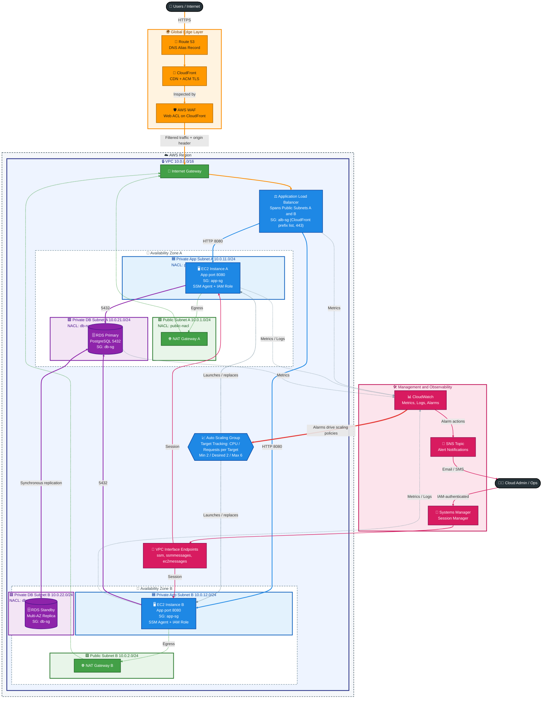

# Project 1: Scalable Web Application with ALB and Auto Scaling

## Architecture Diagram

## Legend

| Color | Layer | Contents |
| --- | --- | --- |
| 🟧 Orange | Global edge | Route 53, CloudFront, WAF |
| 🟩 Green | Public subnets and gateways | NAT Gateways, Internet Gateway |
| 🟦 Blue | Private application tier | ALB, Auto Scaling Group, EC2 instances (port 8080) |
| 🟪 Purple | Database tier | RDS PostgreSQL Multi-AZ (port 5432) |
| 🟥 Magenta | Management and observability | Session Manager, CloudWatch, SNS, VPC endpoints |

| Line style | Meaning |
| --- | --- |
| Solid arrow | Primary request, data, or access path |
| Dotted arrow | Control plane, egress, or telemetry |
| Thick red arrow | CloudWatch alarms triggering Auto Scaling |
